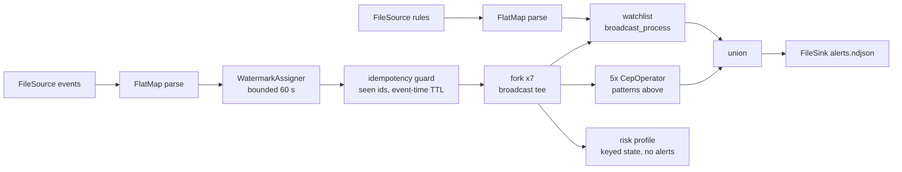
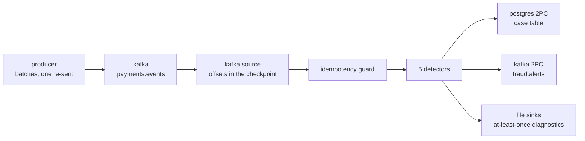
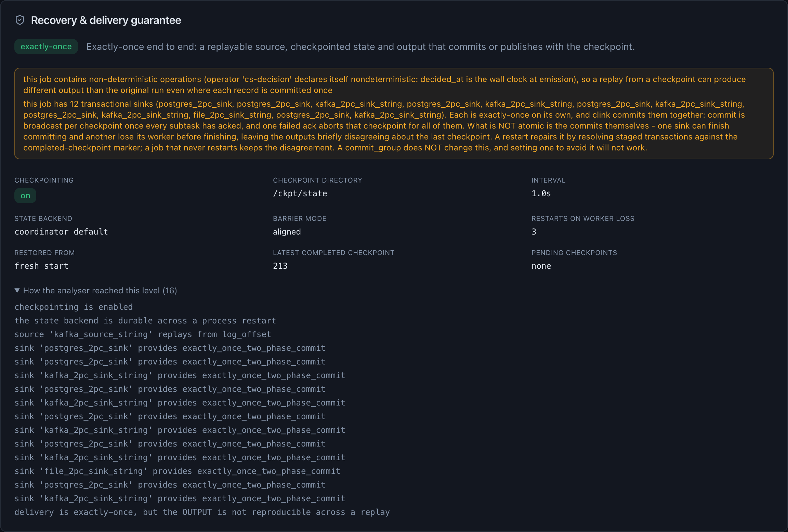
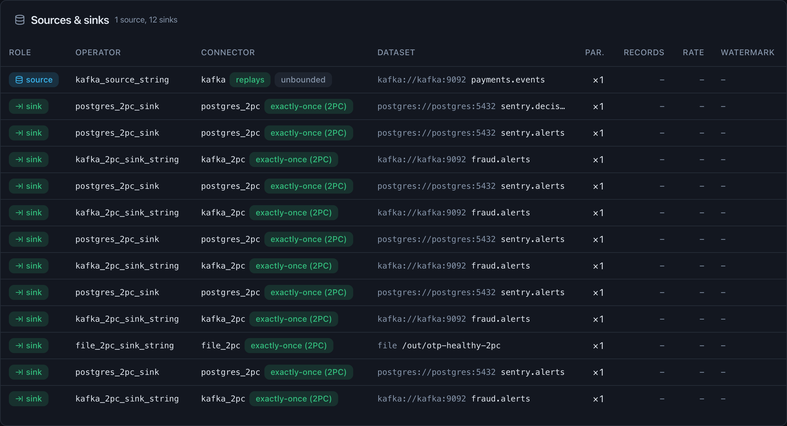

# card-sentry

Card-fraud detection built on [clink](https://github.com/orhaugh/clink)'s
CEP engine, and a worked example of exactly-once transaction processing
around it. One deterministic synthetic tape of card payments and account
activity with labelled fraud campaigns injected, five detectors written
against the native `clink::cep` pattern DSL, and an oracle that gates every
run exactly: every expected alert fired, every negative control stayed
quiet, zero false positives.

Where [market-pulse](https://github.com/orhaugh/market-pulse) is analytics
on a tape (windows, joins, aggregations), card-sentry is detection and
response: sequences, absences, timeouts and dynamic response over the same
engine, and then the delivery of what it detects into the systems that act
on it. It is a downstream consumer, not part of clink - it installs clink
into a local prefix and builds against the installed CMake package the way
any project would.

**What it demonstrates.**

- Embedded detection over the tape, oracle-gated, with per-pattern harness
  tests; dynamic rules over broadcast state; the per-card risk profile
  served over clink's queryable-state HTTP surface.
- The five detectors deployed to a real coordinator and two-worker cluster
  as a compiled job plugin, running the published runtime image.
- **The payment rail**: Kafka in, Postgres and Kafka out under one
  checkpoint, an at-least-once producer that re-sends a batch, and a worker
  killed mid-flight. The case table and the `read_committed` alerts topic
  end holding exactly the manifest's alerts.
- **One decision per authorisation**: every card authorisation is decided
  (clear, review or block) and written to three Postgres tables under one
  checkpoint, one per delivery guarantee: two-phase commit, a keyed upsert and
  a plain insert. The scene measures what each costs in visibility latency and
  what each holds after the kill.
- An idempotency guard in front of the detectors, with its negative control:
  exactly-once delivery does not dedupe the input, and the scene shows what
  happens without the guard.
- The recorded run handed to clink's exactly-once specification: the
  protocol steps the engine took under the kill, followed by the TLA+
  model's checker. The first such run found the model's edge (an interval
  in which a sink stages nothing, which this feed produces almost every
  second); the specification was extended for it, and the run is accepted
  by the extended model and recorded among clink's validated traces.
- Incident replay that freezes a fired alert into a regression bundle, and
  schema evolution of the risk-profile state across a version bump with a
  pre-deploy compatibility gate.

How the guarantees fit together, stage by stage and with their limits, is
written up in [docs/exactly-once-in-practice.md](docs/exactly-once-in-practice.md).
The repository pins clink v0.12.1; `scripts/get-clink.sh` installs it, and
the cluster scenes pull the matching published runtime image.

## Quick start

```bash
# 1. Install the pinned clink release into .clink/prefix
scripts/get-clink.sh

# 2. Generate the tape, build, test, detect, verify - one gate
scripts/run-detections.sh
```

The final line of a good run is the oracle's verdict:

```
OK: every expected alert fired, every control stayed quiet, zero false positives.
```

## The tape

`tools/csgen.py` (seed 7 by default) writes `data/events.ndjson`: three
days of card authorisations, logins, OTP request/verify pairs, password
changes and transfers for a small fleet, in ARRIVAL order. Event time and
arrival order disagree - most events land within 3 seconds of their
timestamp, some up to 40 seconds late - so correct detection needs
event-time watermarks, not file order.

Thirteen campaigns are injected on dedicated entities and recorded in
`data/manifest.json`: nine that must alert, and four negative controls -
sequences engineered to look close to fraud that must NOT alert (a verified
account recovery, a plausible-speed travel pair, an OTP verified near the
window's edge, two band transfers that never reach the structuring
threshold). Noise is generated under invariants that keep it provably
clear of every decision boundary (documented in the generator), so any
alert outside the manifest is a detector or engine bug, and the checker
fails the run. A longer tape (`--days 90`, which the cluster scenes use)
carries the same campaigns spread across its whole length, inside ninety
days of noise.

## The five detectors

Each detector exercises a distinct part of the pattern DSL
(`app/src/patterns.hpp`):

| Pattern | Fraud story | DSL surface it exercises |
|---|---|---|
| `card_testing` | Burst of small declined auths validating a stolen number, then one large approved strike | `.times(4, 20)` quantifier; iterative strike predicate sized against the captured probes; `skip_past_last_event` collapsing suffix partials |
| `impossible_travel` | Two card-present auths at a speed no traveller reaches | Iterative predicate reading the anchor event from the partial match (great-circle distance over elapsed event time) |
| `account_takeover` | Failed logins, password change, draining transfer, and never an OTP verify in between | Two `not_followed_by` negative zones inside one sequence |
| `otp_never_verified` | OTP requested, verification never arrives | The pattern describes the HEALTHY flow; the alert is the **timed-out side output** - the partial that never completed |
| `structuring` | Transfers just under a reporting threshold whose running total crosses the trip line | Complementary iterative predicates: the quantified step captures while the sum stays below the threshold, the tip step takes exactly the transfer that crosses it, so the greedy quantifier can never swallow the trip |
| `watchlist_hit` / `cap_exceeded` | Auths at merchants on a watchlist, or over a per-merchant cap, where the rules arrive on a SECOND stream and change mid-tape without a redeploy | **Broadcast state** (`BroadcastProcessFunction`): effective-dated rules make outcomes depend only on event times, an `end_of_rules` marker seals the set, and a bootstrap buffer keeps early auths from outrunning the rules |

All detectors run in one embedded pipeline (`app/src/card_sentry.cpp`),
behind the idempotency guard and alongside a per-card risk profile that
emits nothing and instead serves its keyed state over HTTP (next section):



Branch threads interleave, so the alert file's order varies run to run;
the alert SET is deterministic, and the checker compares sets.

## Live risk lookup: state served, not exported

`app/src/risk_profile.hpp` folds every auth into a per-card profile held
in a keyed-state slot - checkpointable, restorable, harness-inspectable -
and registers a JSON lookup plus a bounded scan in clink's
queryable-state registry. With `--serve-state <port>` the app hosts the
engine's own HTTP routes once the tape drains:

```bash
curl 'localhost:7071/api/v1/queryable_state/op/cs/subtask/0/json/risk_profile?key=9001'
# {"key":"9001","value":{"card":9001,"auths":7,"declines":6,...,"score":100}}
```

`scripts/scene-risk-lookup.sh` gates the served JSON against an
expectation computed independently from the tape by Python: point lookups
field for field, a 404 for a card that never authed, and the `/scan`
route returning profiles - state as a table over HTTP, no export step.

## The same detectors, on a cluster

`app/src/card_sentry_job.cpp` packages the five CEP detectors as a
compiled job plugin (`CLINK_REGISTER_JOB`), sharing the pattern builders
and alert selectors in `patterns.hpp` with the embedded pipeline - the
two deployments cannot drift. Inline CEP lambdas are in-process-only on
the plain fluent path; packaging them as a plugin is exactly what makes
them cluster-runnable, so the constraint becomes the demonstration. One
rule follows from that model: `define_job` runs in every process that
loads the plugin, the submitter and then each worker, so anything an
operator needs at run time has to travel in the spec as a parameter, and
the graph's shape must not depend on the environment at all. A value
captured from the environment at define time is whatever that process's
environment says, which is how the guard's TTL first failed to reach the
workers; a graph that gains or loses an operator by environment renumbers
the inline operators, which is how the first negative control was refused
at planning. The guard is therefore always in the graph, with its TTL and
its on/off switch as parameters.

`cluster/run.sh` brings up a coordinator and two workers (compose, on the
published `clink-runtime` image at the pinned release), compiles the
plugin INSIDE that image - a job `.so` must be built on the workers'
platform against the same clink commit, and the image bakes the SDK
precisely so both are guaranteed - submits it with `clink_submit_job` (also
in-image: the submitter dlopens the Linux `.so`), and gates
`out-cluster/alerts-*.ndjson` against the manifest restricted to the five
shipped patterns:

```
submit: name=card-sentry completed=1 ok=1
alerts: 9 written, 9 expected
OK: every expected alert fired, every control stayed quiet, zero false positives.
```

The OTP detector's alert channel is the fluent timed-out side output end
to end: through the spec, the planner's chains, and the workers' network
channels. The dashboard is live at http://localhost:8081 during the run
(`KEEP_UP=1` leaves it up).

## The payment rail: Kafka in, two stores out, a worker killed mid-flight

`cluster/run-rail.sh` is the transaction-processing scene. The detectors
read a Kafka topic instead of a file, and every alert lands in two places
under one checkpoint: the Postgres case table through clink's two-phase
commit sink (`PREPARE TRANSACTION` at the barrier, `COMMIT PREPARED` when
the checkpoint is globally durable) and a Kafka alerts topic inside a
broker transaction that commits with the same checkpoint. The feed arrives
the way a rail delivers it: in batches, from an at-least-once producer
that re-sends one batch it had already delivered. Once the case table
shows alerts committing and batches are still to come, a worker is killed
`-9`; the coordinator rolls the job back to its last checkpoint and
redeploys, the Kafka source resumes from its checkpointed offsets, and the
remaining batches are detected by the redeployed job.



The gates read the stores from outside the engine: the case table with
`psql`, the topic with the broker's console consumer at
`isolation.level=read_committed`:

```
== submitting: kafka source, idempotency guard ON (TTL 30 days of event time), postgres 2PC + kafka 2PC alert sinks, decisions to postgres 2PC + upsert + append, diagnostics files on, checkpoints every 1000 ms
job 1 accepted and RUNNING (28 subtasks); the submit's completion wait was not waited for - a topic has no end
== producing the feed in 16 batches; batch 2 is re-sent after batch 3
   batch 2 produced; case table: 1 alert(s) committed
   batch 2 re-sent: the producer timed out on its ack and retried
   batch 3 produced; case table: 4 alert(s) committed
== killing worker2 -9 now: 4 alerts committed, batch 4 in flight, 12 batches still to come
   coordinator: worker lost: worker-2 (heartbeat timeout)
   coordinator: restore point: checkpoint 18 (latest_completed=18 latest_confirmed=18 tracked=5)
   worker2 killed; compose restarts it, the coordinator rolled the job back to that checkpoint and redeployed on the survivor
   batch 5 produced; case table: 4 alert(s) committed
   ...
   batch 15 produced; case table: 9 alert(s) committed
== gate 1: the case table against the manifest (exactly-once into postgres)
alerts: 9 written, 9 expected
OK: every expected alert fired, every control stayed quiet, zero false positives.
== gate 2: the alerts topic, read_committed, against the manifest (exactly-once into kafka)
alerts: 9 written, 9 expected
OK: every expected alert fired, every control stayed quiet, zero false positives.
alerts topic: 9 records on the log, 9 visible to a read_committed consumer
events topic: 845745 records for 795995 distinct events (49750 duplicates from the retried batch)
== verdict
OK: a worker died mid-flight and a batch was delivered twice; the case table and the
    read_committed alerts topic both hold exactly the manifest's alerts.
```

When the kill catches an interval in flight, the same consumer at
`read_uncommitted` also shows the records the aborted transaction left on
the log, which a transactional consumer never sees; one run recorded here
had eleven records on the log and ten visible. `GUARD_DEBUG=1` adds the
guard's own account from the worker log: the restored incarnation opens
with `199000 entries restored`, the ids of the four batches already seen,
which is the keyed state the restore brought back. The file-sink outputs
are at-least-once by design; the coordinator says so when it labels the
job's delivery guarantee by its weakest sink. The exactly-once contract is
the two stores the gates read.

Two sinks commit on the same per-checkpoint decision, and there is no
cross-sink atomic commit: a crash between the two commits is healed by
recovery, so for a completed checkpoint both stores end holding the
interval. The design note spells out why "both end committed" is the
honest claim and "atomic" is not.

## One decision per authorisation, three stores

Alerts are rare: nine in ninety days. Decisions are not. Every card
authorisation is owed one, and something downstream acts on each: a hold, a
step-up, a review. The rail job adds that path. A keyed operator
(`app/src/decision.hpp`) decides every authorisation the guard admits, from
the card's declines in the last hour of event time, its last position and the
amount, and the one decision stream fans out to three Postgres tables under
the same checkpoint:

| Table | Sink | Guarantee | Visible |
|---|---|---|---|
| `decisions` | two-phase commit | exactly-once | when its checkpoint completes |
| `decisions_fast` | upsert by authorisation id | effectively-once | at each flush |
| `decisions_append` | plain insert | at-least-once | at each flush |

With the decision stores on, the kill lands while the next batch's decisions
are landing, so the failure cuts an interval that holds rows. Gate 3 reads all
three tables with `psql`, and Postgres's commit timestamps give each table's
visibility latency: when the transaction that wrote a row committed, minus
when the operator emitted it.

```
== gate 3: the decision stores, one decision per authorisation across three delivery tiers
authorisations in the feed: 569873 (each decided once by the operator; the re-sent batch's were dropped by the guard)
decisions, two-phase commit:  569873 rows, 569873 distinct ids
decisions_fast, upsert by id: 569873 rows; rows that differ from the two-phase-commit table: 0 + 0
decisions_append, plain insert: 577473 rows, 569873 distinct ids: 7600 duplicate row(s), the replayed interval inserted again (at-least-once, by design)
by outcome: block=4 clear=559305 review=10564
visibility latency per store: the commit timestamp of the row's transaction minus the operator's emission time, in ms (checkpoints every 1000 ms)
   decisions         p50   1019 ms   p95   2216 ms   max   3004 ms
   decisions_fast    p50     17 ms   p95     82 ms   max    280 ms
   decisions_append  p50     17 ms   p95     83 ms   max    208 ms
OK: one decision per authorisation in the two-phase-commit table, and the keyed table holds the same decisions, row for row.
```

The two-phase table holds one row per authorisation and nothing else. The
keyed table converged to the same rows, value for value, which is the part
that needs saying: the replayed interval rewrote rows a reader may already have
seen, and it rewrote them to the same decisions because the operator's state
was restored to the checkpoint and the input replayed in order. The append
table kept the replay: 7,600 rows inserted twice. The latency column is the
price of the first table: its rows wait for the checkpoint, about a second at
the median with a one-second interval, and the other two do not.

Which table a consumer reads is a question about what it does with a row.
Something that acts once per row, opening a case or holding a card, reads the
two-phase table or dedupes by id itself. Something that wants the latest
decision per authorisation can read the keyed table and its tens of
milliseconds, on two conditions the scene makes visible. The decision must be
reproducible from state and input, because the replay rewrites visible rows;
the operator declares its one wall-clock field (`decided_at`) to the engine,
whose analyser then warns that output is not reproducible across a replay, and
the gate compares the tables on every other column. And anything that follows
the keyed table's changes sees each replayed row change again, so it must be
idempotent by id too. The latency also says where this path belongs. A
decision that must stop an authorisation before it completes is on the request
path, in milliseconds; what a stream decides is post-authorisation, a hold or a
step-up a few hundred milliseconds or a second later.

`DECISION_TIERS=2pc DIAG=0 cluster/run-rail.sh` keeps only the transactional
stores, so every sink in the job is exactly-once: the Postgres and Kafka alert
sinks, the two-phase decision table, and the exactly-once file sink for the OTP
detector's healthy branch. The coordinator then labels the whole job
end-to-end exactly-once, and an ops console reading its API shows the verdict
beside what it rests on:



The analyser's verdict is end-to-end exactly-once, and it says what that rests
on (a replayable Kafka source, checkpointing, a durable state backend, twelve
two-phase sinks) and what it does not cover: the decision operator declares
its wall-clock field, so a replay can produce different output even though
each record is committed once, and twelve transactional sinks commit together
but not atomically. The same job's sources and sinks, each with the delivery
its capability record declares:



The console is [clink-fe](https://github.com/orhaugh/clink-fe), pointed at the
scene's coordinator (`VITE_CLINK_TARGET=http://127.0.0.1:8081 npm run dev`)
while `KEEP_UP=1` keeps the cluster running.

## Idempotency is not exactly-once

The producer re-sends a batch; every record in it is on the topic twice
under the same id. Exactly-once processing guarantees that each of those
records affects the output exactly once, which is twice. The guard in
front of the detectors (`app/src/idempotency.hpp`) is where the domain
knowledge enters: two records with one id are one event. Its seen-set is
keyed state under an event-time TTL, checkpointed with everything else, so
a restore meets the same answers. The TTL is the declared edge: a producer
whose replay horizon is a day needs a day-long TTL.

`GUARD=0 cluster/run-rail.sh` is the negative control. With the guard
switched to pass-through the re-sent batch reaches the detectors twice -
the same probes and strike match again, a second OTP request times out -
and the oracle fails, which the script expects. `GUARD_TTL_DAYS=1` is the
horizon control: the tape compresses ninety days into seconds, one batch
is 5.6 days of event time, and a day-long TTL has forgotten the batch's
ids by the time it is re-sent, so the oracle fails the same way. The scene
runs with a 30-day TTL because that is the horizon this producer has.

```
== submitting: kafka source, idempotency guard OFF, postgres 2PC + kafka 2PC alert sinks, decisions to postgres 2PC + upsert + append, diagnostics files on, checkpoints every 1000 ms
...
== gate 1: the case table against the manifest (exactly-once into postgres)
alerts: 11 written, 9 expected
FAIL (4):
  - expected 1 alert(s) for ('card_testing', 'card', 9001), got 2
  - expected 1 alert(s) for ('otp_never_verified', 'account', 8101), got 2
  - unexpected alert x1: ('card_testing', 'card', 9001) (noise must never alert)
  - unexpected alert x1: ('otp_never_verified', 'account', 8101) (noise must never alert)
== gate 2: the alerts topic, read_committed, against the manifest (exactly-once into kafka)
alerts: 11 written, 9 expected
FAIL (4): (the same four)
alerts topic: 12 records on the log, 11 visible to a read_committed consumer
== gate 3: the decision stores, one decision per authorisation across three delivery tiers
decisions, two-phase commit:  605526 rows, 569873 distinct ids
without the guard the re-sent batch was decided twice: the two-phase-commit table shows the input's duplication
   (35653 extra rows); a keyed store collapses it to one row per id and hides it.
== verdict
OK (negative control): without the idempotency guard the retried batch reached the detectors
    twice and the oracle failed, as it must. Exactly-once delivery did not, and cannot, dedupe the input.
```

The two stores still agree with each other to the row: the engine
delivered every detector emission exactly once. The duplication is in the
input, and only the domain's idempotency key can see it. The decision tables
make the same point from the other side: the two-phase table holds the 35,653
authorisations of the re-sent batch twice, exactly once each time, and the
keyed table, upserting by id, shows one row for each and hides that anything
happened.

## The run, checked against the protocol's specification

clink ships its exactly-once protocol as a TLA+ specification that the
model checker verifies in its CI, and every clink process can record the
protocol steps it takes. `TRACE=1 KAFKA_ALERTS=0 cluster/run-rail.sh`
records the rail run - barriers delivered, transactions prepared,
checkpoints completed, commits delivered, the worker lost, the job
redeployed - and `cluster/validate-trace.sh` has TLC follow that record
through the specification. The run is accepted only if some path through
the model produces every recorded step in order; otherwise the first step
no rule allows is named. The specification's trace module models one sink
family per job, the Kafka family with its receipts and confirmations or
the recoverable family Postgres belongs to, so the traced run keeps the
case table as its one exactly-once store; the mixed run above is judged by
its gates, and the validator refuses a mixed trace rather than guessing.

```
trace: 2982 protocol events from 3 process files
   SubtaskAck x1202
   SinkConfirm x756
   SinkPrepare x315
   DeliverCommit x315
   Trigger x68
   DeliverBarrier x68
   WriteCompleted x63
   CoordComplete x63
   Broadcast x63
   Placement x38
   SubtaskDrained x10
   SinkOpens x10
   SinkCommit x9
   WorkerDies x1
   Redeploy x1
formal-check: TLC trace/trace (2982 events)
formal-check:   DIVERGES after 1s at event 54: {"seq":30,"ts":1792685352395602,"proc":"worker:1","event":"DeliverCommit","sub":10,"ckpt":1,"accepted":false}
formal-check:   no step of the specification produces this event from any state the trace reached
```

The checker stopped at the first commit a sink declined, and that was the
honest result against clink v0.11.0's specification: it modelled every
prepare as staging a transaction, and this feed is nine alerts in ninety
days, so in most intervals a sink receives nothing, stages nothing and
declines the commit with nothing to do. clink's own traced workloads carry
records in every interval and never produced that step; a fraud feed
produces it every second. Which is what a specification is for: when the
run and the model disagree, one of them is wrong, and the checker names the
exact step to look at. The specification was then extended (an empty prepare
that stages nothing, a ghost fixing a position's answer across a replay,
invariants that ask nothing of a sink at an interval it found empty),
released in clink v0.12.0, and against it the run is accepted. With the
decision stream beside the alerts, the traced run now carries a dense
two-phase table next to the sparse case table, a worker killed mid-batch and
a restart, and is accepted all the same:

```
trace: 4811 protocol events from 3 process files
   SubtaskAck x1967
   SinkConfirm x1275
   SinkPrepare x512
   DeliverCommit x510
   Trigger x90
   DeliverBarrier x90
   WriteCompleted x85
   CoordComplete x85
   Broadcast x85
   Placement x46
   SinkCommit x39
   SubtaskDrained x12
   SinkOpens x12
   WorkerDies x1
   RestartOnError x1
   Redeploy x1
formal-check: TLC trace/trace (4811 events)
formal-check:   accepted in 16s: every event is a step the specification allows
validate-trace: the recorded run is a behaviour of the exactly-once specification
```

The first accepted run of this scene (4,281 events, 455 prepares, 9 of them
staged) is one of the recorded traces clink validates on every push.
`cluster/validate-trace.sh` takes the specification from the pinned release;
`CLINK_SPEC_SOURCE=/path/to/clink` points it at a newer checkout.

## Kill the detector, the case table doesn't lie

`cluster/run-2pc.sh` is the bounded variant: the ninety-day tape read from
a file, the Postgres case store, a worker killed `-9` mid-run. The
coordinator rolls the whole job back to the last checkpoint, redeploys on
the survivor, the source rewinds to its snapshotted offset, and the job's
final checkpoint commits the tail; the case table ends holding **exactly**
the manifest's alerts:

```
== killing worker2 mid-run
case table: 9 rows, expected 9
OK: killed a worker mid-run; the case table holds exactly the manifest's alerts.
```

## Every alert is evidence

`cluster/replay.sh` runs the detectors with the flight recorder armed,
then - offline, engine stopped - `capture-cat` lists what each operator
consumed per epoch, `clink replay --verify` re-executes an epoch
byte-identically, and `--emit-test` freezes it into a self-contained
regression bundle. For fraud, "why did the detector fire at 09:17" is a
compliance question; replay makes the answer reproducible and turns the
incident into a permanent test. The detectors are custom-typed
(`cs_event->cs_alert`), and replay handles those plugin types, not just SQL
rows.

## The upgrade nobody notices

`app/src/risk_profile_v2.hpp` evolves the per-card profile to v2 (adds a
first-seen timestamp) with a registered `1->2` migration.
`app/tests/schema_evolution_test.cpp` shows the consumer contract: a v1
savepoint value migrates to v2 preserving every field, and clink's
pre-deploy compatibility gate passes once the migration is registered and
flags the same upgrade as incompatible without it - stopping a
data-losing deploy before it starts.

## Verification

Three independent gates, all run by `scripts/run-detections.sh`:

1. **Harness tests** (`app/tests/patterns_test.cpp`): each detector driven
   through clink's public testing framework with explicit event times and
   watermarks - match, non-match, negation, timeout and skip behaviour
   pinned per pattern, plus a codec round-trip, the idempotency guard's
   drop-and-expire contract, and the decision operator's outcomes, decline
   window and restore.
2. **The oracle** (`tools/check.py`): the tape run's alerts against the
   manifest - exact multiset equality on the expected alerts, silence from
   every negative control, and zero alerts anywhere else.
3. **Determinism**: same tape, same alert set, every run.

The cluster scenes reuse the same oracle over what they read back from the
stores: the case table rendered as JSON rows, the alerts topic as consumed.
The rail scene's decision gate counts against the tape itself: one
two-phase row per authorisation in the feed, the keyed table equal to it on
every column but the wall-clock one.

## Layout

```
scripts/get-clink.sh            install clink (release tag, or CLINK_SOURCE=<checkout>)
scripts/run-detections.sh       generate -> build -> test -> detect -> verify
scripts/scene-risk-lookup.sh    queryable-state scene: served profiles vs the tape
cluster/run.sh                  cluster scene: in-image plugin build -> submit -> gate
cluster/run-rail.sh             payment rail: kafka in, postgres + kafka 2PC out, worker kill;
                                one decision per authorisation into 2PC / upsert / append tables;
                                GUARD=0 negative control, TRACE=1 specification check,
                                DECISION_TIERS=2pc DIAG=0 for an end-to-end exactly-once job
cluster/validate-trace.sh       a recorded run against clink's exactly-once specification
cluster/run-2pc.sh              bounded tape, Postgres 2PC + kill-a-worker; NO_KILL / NO_PG switches
cluster/replay.sh               capture -> replay --verify -> --emit-test bundle
cluster/docker-compose.yml      coordinator + two workers + postgres (+ kafka under the rail profile)
docs/exactly-once-in-practice.md  the guarantees, stage by stage, and where they stop
docs/screenshots/               the rail job in the clink console
tools/csgen.py                  deterministic tape + rules + manifest generator
tools/railfeed.py               the tape as producer batches, one of them re-sent
tools/check.py                  the oracle (--only-patterns for subset deployments)
app/src/events.hpp              event model, parser, codecs, haversine, alerts
app/src/idempotency.hpp         the idempotency guard (keyed seen-set, event-time TTL)
app/src/decision.hpp            the decision operator: one decision per authorisation
app/src/patterns.hpp            shared pattern builders + alert selectors
app/src/rules.hpp               effective-dated rule model + codec
app/src/watchlist.hpp           broadcast-state watchlist detector
app/src/risk_profile.hpp        per-card profile + queryable-state binding
app/src/risk_profile_v2.hpp     the evolved profile (v2) + the v1->v2 migration
app/src/card_sentry.cpp         the embedded pipeline
app/src/card_sentry_job.cpp     the same detectors as a job plugin (.so); file or kafka source
app/tests/patterns_test.cpp     harness tests per detector, the guard and the decision operator
app/tests/schema_evolution_test.cpp   migration + pre-deploy compatibility gate
```

## Pinning

`scripts/get-clink.sh` installs into `.clink/prefix`; nothing touches
system paths. Release mode installs a pinned tag (currently v0.12.1) and
`CLINK_SOURCE=/path/to/clink` installs a local working tree
into the identical layout - the consumption seam (installed package + CLI)
is the same in both modes, so flipping between them changes nothing in
this repository. The install stamp records the source commit and a
`-dirty` marker; a dirty tree always reinstalls. The cluster scenes run
the published `ghcr.io/orhaugh/clink-runtime` image at the same release
and build the job plugin inside it, so the plugin and the engine agree by
construction; `CLINK_IMAGE` points them at a locally built image instead.

## Licence

Apache-2.0.
