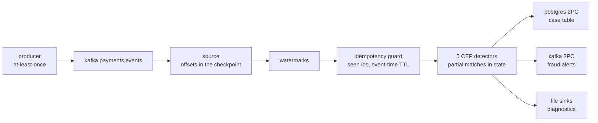

# Exactly-once in practice

What the payment rail in this repository guarantees, how each guarantee is
checked from outside the engine, and where it stops. The scene is
`cluster/run-rail.sh`; the job is `app/src/card_sentry_job.cpp`.

Exactly-once is a property of a whole path, never of one component. A
transactional sink in front of a source that replays from the wrong place
is at-least-once; an exactly-once engine behind a producer that retries is
counting duplicates exactly once. The useful statement is per stage: what
this stage promises, under which failure, and what proves it.

## The vocabulary, pinned down

| Term | Meaning here |
|---|---|
| At-least-once | A failure can make an effect happen twice. The file sinks in this repository are this, on purpose, as diagnostics. |
| Exactly-once processing | Source positions, operator state and staged output move together in one consistent cut. A restore rewinds all three to the same point, so no record's effect on state is counted twice or lost. |
| End-to-end exactly-once | An effect outside the engine becomes visible if, and only if, the cut that produced it completed. This needs the external system to hold a prepared-but-invisible state: a prepared transaction, a staged object, an uncommitted broker transaction. |
| Effectively-once | The external effect is idempotent, so a replay converges to the same final state. Upsert by primary key is the common form. No two-phase commit, no prepared state, lower latency, and only for keyed, convergent outputs. |

Exactly-once never means a record is physically delivered once. Records
are replayed after every failure. It means the record's effect is counted
once.

## The rail, stage by stage

| Stage | Mechanism | Promise | What would break it |
|---|---|---|---|
| Producer | The broker's console producer, one batch re-sent | None beyond at-least-once. The re-sent batch is on the topic twice. | Nothing to break; this is the input's honest contract. |
| Source | Per-partition offsets written into operator state at every barrier; a restore seeks to them. The consumer group id is a courtesy for tooling, never the resume authority. | After a restore the job re-reads exactly the records after the cut. | Letting the client auto-commit group offsets: a restore would then resume past records whose effects died with the rewound attempt. |
| Guard | Keyed state by event id under an event-time TTL; the first sighting passes, later ones drop. Checkpointed with everything else. | A record replayed by the producer inside the TTL affects nothing. | An id that reappears after the TTL horizon is admitted again. The horizon is a declared bound, not a hope. |
| Detectors | CEP partial matches and the OTP timers live in keyed state; the barrier snapshots them. | A detector restored from a checkpoint continues the same partial match. | Matching runs in arrival order; a step gap shorter than the arrival skew needs a reordering stage upstream. |
| Postgres sink | Rows go into an open transaction; the barrier issues `PREPARE TRANSACTION` under a deterministic id; `COMMIT PREPARED` runs when the coordinator reports the checkpoint complete. At open, the sink commits any prepared transaction in its restored state and rolls back its own orphans. | A row is visible iff its checkpoint completed. A crash between prepare and commit loses nothing: the prepared transaction is durable on the server and is committed at the next open. | `max_prepared_transactions = 0` on the server. Two sinks sharing an operator id, so their prepared transactions collide. |
| Kafka sink | Records are produced inside a broker transaction sealed at the barrier and committed on the coordinator's commit broadcast; a commit receipt is written the moment the broker acknowledges. | A `read_committed` consumer sees an interval iff its checkpoint completed. Aborted transactions from a killed worker stay on the log, invisible to that consumer. | A consumer reading uncommitted. A transaction that expires at the broker during an outage longer than its timeout, which the documented floor bounds to one interval of duplicates. |
| File sinks | Append at the barrier | At-least-once | By design. They exist so a human can read what a detector saw. |

## What a checkpoint is

A checkpoint is a cut across the running job: the barrier flows in band
with the records, every operator snapshots its state as the barrier
passes, multi-input operators align it across their inputs, and each
sink prepares what it received before the barrier. The coordinator
declares the checkpoint complete only when every subtask has acknowledged
after its durable write, writes a completion marker, and only then
broadcasts the commit. Four things therefore refer to the same logical
point: the source positions, the operator state, the prepared outputs, and
the marker that makes the decision durable.

The cost of putting external visibility behind that decision is latency:
an alert becomes visible to a `read_committed` consumer or a case-table
reader one checkpoint interval plus one commit after the detector fired.
The scene runs a one-second interval, which is a demonstration setting; a
production setting is a trade between visibility latency, the amount of
work a restore replays, and the rate of prepared transactions the stores
are asked to hold.

## Two-phase commit, honestly

Phase one happens at the barrier, in every sink, without waiting for
anyone. Phase two happens after one decision by the coordinator. The
decision's durable record is the completion marker, and for jobs with a
Kafka transactional sink also a confirmation marker, written once every
such sink has confirmed its commit executed, because a broker transaction
cannot be re-committed by a new producer the way a prepared Postgres
transaction can.

What happens under each failure:

- A worker dies after preparing and before the commit reaches it. The
  prepared state is on the server, not in the process. Postgres holds the
  prepared transaction and its locks; Kafka holds the transaction open and
  pins the last stable offset, so `read_committed` consumers wait. The
  restored sink commits what the completed checkpoint covers and rolls back
  what it does not. The cost of 2PC under failure is latency, never
  correctness.
- A worker dies before the barrier reached its sink. Nothing was prepared;
  the restore replays the interval from the source positions in the last
  completed checkpoint.
- The coordinator dies between completing a checkpoint and broadcasting
  the commit. This is the classic blocking case. clink's coordinator
  persists each job's manifest and plugin, restarts from the markers, walks
  every in-doubt handle before it redeploys anything, and for Kafka reads
  its own commit receipts rather than asking the broker whether a fenced
  transaction had committed. The scene does not kill the coordinator; the
  engine's own integration suite and its qualification campaigns do.
- Two sinks, one checkpoint. Every transactional sink of a job commits on
  the same per-checkpoint broadcast. There is no cross-sink atomic commit,
  and a `commit_group` does not add one; the engine's documentation says so
  plainly. What holds is weaker and still what matters: after a crash
  between the two commits, recovery commits the prepared Postgres
  transaction at open and finalises the Kafka transaction through its
  receipt or the in-doubt walk, so for a completed checkpoint both stores
  end holding the interval. Say "both end committed", never "atomic".

What 2PC asks of the stores: prepared transactions hold locks and count
against `max_prepared_transactions`; a broker transaction has a timeout
(60 seconds by default) past which the broker aborts it; a transactional
sink must stand alone on its chain so the checkpoint's acknowledgement
waits for its prepare. All three are operational facts to monitor, not
surprises.

## When not to use it

Two-phase commit is for facts: an alert fired, a case was opened, a
payment was authorised. Those are appended, consumed by systems that are
not idempotent, and a duplicate is a second case. A keyed, convergent
output, such as a running balance per account, a latest-state row per
card, or a feature vector, is better served by an idempotent upsert on its
primary key: a replay rewrites the same rows to the same values, there is
no prepared state anywhere, and visibility does not wait for a checkpoint.
clink offers both and refuses to label the upsert path exactly-once; it is
effectively-once, for a stable key and a deterministic query. Choosing
between them is a question about the output's shape, not about how much
one trusts the engine.

## The decision path: what visibility costs

The rail measures the trade the previous section describes. One stream of
post-authorisation decisions, one per card authorisation, goes to three
Postgres tables under the same checkpoint, and the scene reads each table's
visibility latency from Postgres itself: the commit timestamp of the
transaction that wrote a row (`track_commit_timestamp`) minus the time the
operator emitted it.

| Table | Sink and guarantee | p50 | p95 | max |
|---|---|---|---|---|
| `decisions` | two-phase commit, exactly-once | 1,019 ms | 2,216 ms | 3,004 ms |
| `decisions_fast` | upsert by authorisation id, effectively-once | 17 ms | 82 ms | 280 ms |
| `decisions_append` | plain insert, at-least-once | 17 ms | 83 ms | 208 ms |

One run on clink v0.12.0: 569,873 decisions, a one-second checkpoint
interval, a worker killed while a batch's decisions were landing. Afterwards
the two-phase table held one row per authorisation, the keyed table the same
rows column for column bar the wall-clock one, and the append table 7,600
rows twice.

The two-phase table's latency is the checkpoint: a row waits for the barrier
that closes its interval, for every subtask to acknowledge, for the completion
marker, and for `COMMIT PREPARED`. A shorter interval cuts it and asks more of
everything else (more prepared transactions, more markers, more acknowledgements
per second). The upsert and append tables commit at their flushes, so their
latency is the flush cadence, not the checkpoint's.

What the upsert table's speed is bought with:

- Rows are visible before their checkpoint completes, so a failure can rewrite
  rows a reader has already seen. The rewrite is harmless only if the replay
  produces the same values, which holds when the operator's output is a
  function of its restored state and its input. The decision operator stamps
  one field from the wall clock and declares itself nondeterministic to the
  engine for that reason; the delivery analyser then warns that the job's
  output is not reproducible across a replay, and the gate compares the two
  tables on every column but that one. An operator that called a remote model
  or read a clock into its decision could not make this claim, and its keyed
  table would show a decision flipping under a reader after a failure.
- Change data captured from the upsert table carries every rewrite as a change,
  so a consumer of that feed is at-least-once and must dedupe by id.
- The key must be the decision's identity. Here it is the authorisation's event
  id, which the idempotency guard already treats as the event's identity.

The append table is what neither guarantee gives: after the kill it holds the
replayed interval twice, row for row.

A payments platform needs both tiers, for different readers. The case table and
the two-phase decision table are the record: an auditor, a case-management
system, a regulator's report. The keyed table is the working copy a
latency-bound consumer reads. The authorisation decision itself, the one that
approves or declines while the cardholder waits, is on neither: it belongs on
the request path, and the stream decides what happens next.

## Idempotency is not exactly-once

The producer in the scene re-sends a batch it had already delivered. Every
record in that batch is on the topic twice, with the same id and the same
payload. The engine reads both, and exactly-once processing guarantees
each of them affects the output exactly once: which is twice. The
card-testing detector matches the same probes and strike again; an OTP
request that was never verified times out a second time; a structuring
detector would sum a transfer twice. `GUARD=0` runs exactly that and the
oracle fails, as it must, with the two campaigns of the re-sent batch
alerting twice in both stores.

The idempotency guard is where the domain knowledge enters: two records
with one id are one event. The id has to be assigned by the producer at
the moment the event exists, never derived from the broker offset (which
differs between the original and the retry) and not from a hash of the
payload alone (two genuine events can carry identical payloads). The
guard's seen-set is bounded by an event-time TTL, which is the contract's
edge: a producer whose replay horizon is a day needs a day-long TTL, and
the state cost is the number of distinct ids inside it. It is checkpointed
like any other state, so a restore meets the same answers the original run
gave.

The scene makes that edge concrete, because it was met while building it.
The tape compresses ninety days into seconds of wall-clock time, so one
producer batch is 5.6 days of event time, and the re-sent batch arrives
after the following batch has moved the watermark a further 5.6 days on.
With the guard's default 24-hour TTL its ids had expired by then, the
retry was admitted, and the oracle failed with the same card-testing
evidence matched twice, in both stores. The scene therefore runs the guard
with a 30-day TTL and keeps `GUARD_TTL_DAYS=1` as the horizon control that
reproduces the failure on demand. The general lesson is the one above: the
TTL is a statement about the producer's replay horizon, measured in the
stream's own time, and a replay that lands outside it is indistinguishable
from a new event.

The second half of that debugging is a lesson about plugins rather than
about TTLs. Raising the TTL did not remove the duplicate when the re-sent
batch straddled the kill, and a run that re-sent the batch only after the
restore was clean, which cleared the restore itself. The cause was that
the TTL had never reached the workers: a plugin's `define_job` runs in
every process that loads it, the submitter and then each worker, and a
value an operator captures from the environment at define time is that
process's environment. The workers were running the default. Only the
spec travels, so the guard is now a named operator whose TTL is a spec
parameter, and the rule is stated in the job's source. Its corollary
arrived with the negative control: a graph whose shape depends on the
environment renumbers its inline operators between the submitter and the
workers, and the planner refuses the spec. The guard therefore stays in
the graph and is switched off by a parameter.

## Proof rather than assertion

- The oracle is independent of the engine. The generator writes the
  manifest of expected alerts and keeps the noise provably clear of every
  decision boundary, so set equality is the test: nothing missing, nothing
  extra, controls silent.
- The stores are read with the tools their users would use: `psql` on the
  case table and the broker's console consumer with
  `isolation.level=read_committed`. The same consumer with
  `read_uncommitted` shows the records the killed worker's aborted
  transactions left behind, which is what a transactional consumer is
  protected from.
- The kill is triggered by progress, not by a timer: once the case table
  holds a few committed alerts and batches are still to come. Alerts
  therefore commit on both sides of the failure, and the batches produced
  after it prove the source resumed from its checkpointed offsets.
- With `TRACE=1 KAFKA_ALERTS=0`, every process records the protocol steps
  it takes, and the run is checked against clink's exactly-once
  specification, a TLA+ model of barriers, prepares, markers, broadcasts,
  commits, receipts, worker loss and redeploy. The model checker accepts
  the run only if some path through the specification produces every
  recorded step in order. That is a statement about the steps the engine
  took under this failure, not merely about the counts at the end. It
  proves the run is a behaviour of the model; it does not prove the code in
  general, and the specification's own page is careful to say so. The
  model's scope is also explicit, and this scene found two of its edges.
  The trace module takes one sink family per job, so the traced run has
  the Postgres case table as its only exactly-once store, and the mixed
  Kafka-and-Postgres run is judged by its gates; the first traced run of
  the mixed job was refused at its first Postgres prepare. And the
  specification models every prepare as staging a transaction, so a sink
  that received nothing in an interval and declined its commit is the first
  step the checker could not explain. clink's own traced workloads never
  produce that step; a feed with nine alerts in ninety days produces it in
  almost every interval. The specification was extended for it, released
  in clink v0.12.0, which this repository pins: the same run is accepted by
  the extended model (4,281 events, every one a step the protocol allows)
  and recorded among the traces clink validates on every push, and the
  denser run with the decision stream beside it (4,811 events, a worker
  killed mid-batch) is accepted too. The scene still reports the verdict of
  whichever checker it is given. Finding the edge with a realistic workload
  is what the showcase is for.
- `cluster/replay.sh` is the forensic side of the same discipline: the
  flight recorder captures what each operator consumed per checkpoint
  epoch, and an alert can be re-derived offline, byte for byte, and frozen
  into a regression test.

## Where the guarantee stops

- The file sinks are at-least-once and carry duplicates after a restore.
  They are not part of the contract; the scene prints their line count
  beside the case table's row count so the difference is visible.
- Any side effect that is not a transactional sink, such as a call to a
  case-management API from inside an operator, is at-least-once. The
  design answer is an idempotent API keyed by the alert's identity, which
  moves the problem back to the idempotency section.
- The guard forgets an id after its TTL of event-time progress.
- A Kafka transaction that expires at the broker during an outage longer
  than its timeout cannot be committed afterwards. The engine's documented
  floor for that case is at most one checkpoint interval of duplicates, and
  the `read_committed` gate would show them.
- The scene runs one partition and parallelism one. With more, order is
  per key within a partition, each sink subtask carries its own
  transactional id, and keyed state moves between subtasks by key group;
  none of that changes the guarantees above, all of it changes the
  operational picture.
- CEP matches in arrival order. A record that arrives later than the
  watermark bound still reaches the detectors and is matched where it
  lands; only timeouts follow the watermark. A pattern whose step gap is
  shorter than the arrival skew of its events therefore needs a reordering
  stage upstream, and the bound itself has to come from measured arrival
  skew rather than guesswork.
